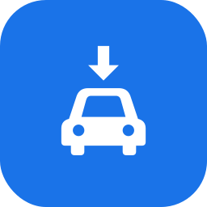
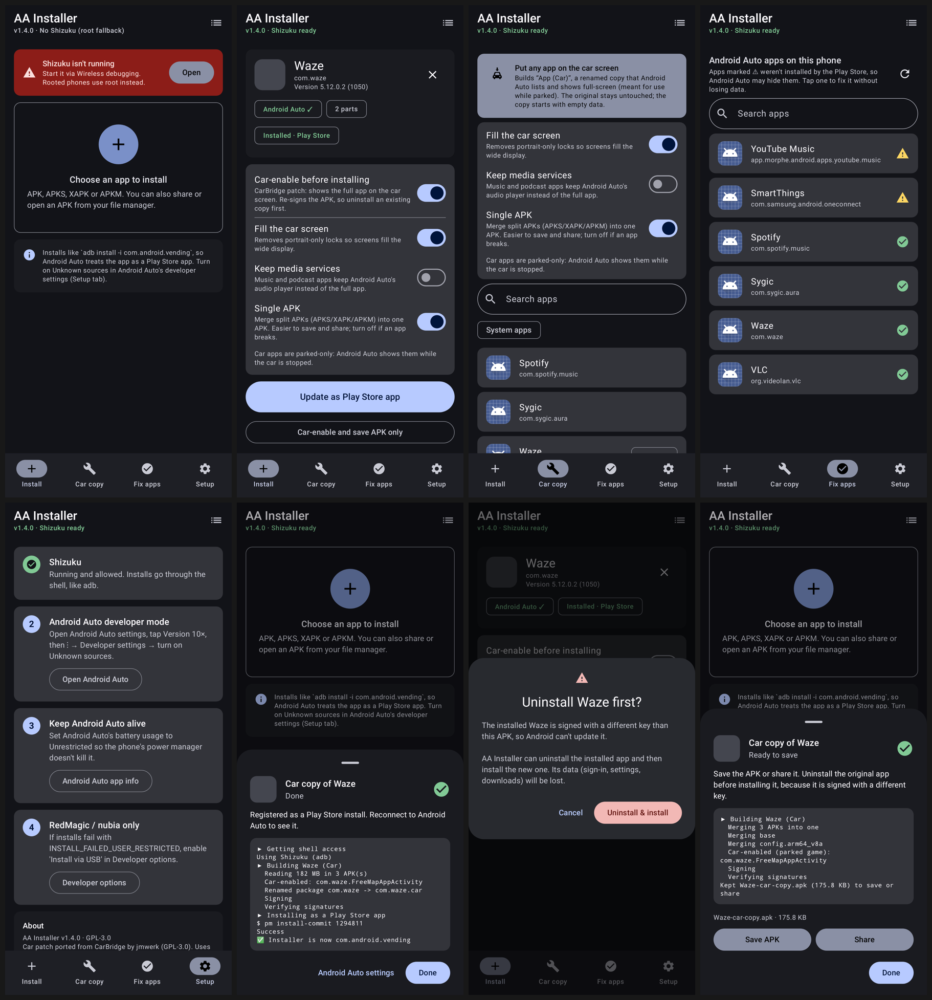

<div align="center">



# AA Installer

**Install Android Auto apps as if they came from the Google Play Store, right on your phone.**

[](https://github.com/j0p3s/AA-Installer/releases/latest)
[](https://github.com/j0p3s/AA-Installer/actions/workflows/build.yml)
[](LICENSE)


</div>

AA Installer does on your phone what this PC command does:

```
adb install -r -i com.android.vending app.apk
```

Android Auto only shows apps whose installer is the Play Store. Apps you sideload are recorded as installed by your file manager or browser, so Android Auto hides them, even when they fully support Android Auto. AA Installer installs them with the Play Store as the installer, through **[Shizuku](https://github.com/RikkaApps/Shizuku)** (no root) or **root**.

It also includes a **parked-only car patch** (from [CarBridge](https://github.com/jmwerk/CarBridge) and [Android Auto Maker](https://github.com/malebuffy/AndroidAutoMaker)), which puts any app's full interface on the Android Auto screen while the car is parked.



## Features

| | |
|---|---|
| **Install** | APK, APKS, XAPK and APKM (split APKs; parts for other CPU architectures are skipped). Shows the app's icon and version, and whether it supports Android Auto. Open or share an APK straight from your file manager. |
| **Safe updates** | Checks the signature and version before updating an installed app. If Android can't update it, AA Installer offers to **uninstall the old version and install the new one**, and explains that the app's data will be lost. |
| **Car copy** | Builds "*App* (Car)", a renamed `<package>.car` copy of any installed app that Android Auto lists and shows full screen. The original app is untouched. |
| **Car-enable before installing** | Applies the car patch to an APK you pick and keeps its package name, like CarBridge Patches for Morphe. |
| **Save & share** | Keep a car-patched app as one APK. **Save** it anywhere or **Share** it, with or without installing. Split APKs are merged into a single APK. |
| **Fix apps** | Lists your Android Auto apps. Any that weren't installed by the Play Store can be re-registered without uninstalling or losing data. |
| **Setup** | A checklist for Shizuku, Android Auto developer mode, battery settings and RedMagic/nubia USB installs, with buttons that open each settings screen. |
| **Crash reports** | If the app ever crashes, the next launch shows the report so you can copy it into an issue. |
| **Privacy** | No internet permission, no ads, no tracking, no accounts. |

## Download

Get the latest APK from **[Releases](https://github.com/j0p3s/AA-Installer/releases/latest)**.

Signing certificate SHA-256, to check with [AppVerifier](https://github.com/soupslurpr/AppVerifier):

```
io.github.j0p3s.aainstaller
5E:FA:6B:83:CC:9A:A8:8F:92:E8:F3:0B:21:6C:51:00:1E:B0:B6:9C:40:E2:A9:4B:E9:57:2D:83:4E:3A:DB:92
```

## Quick start

1. Install **Shizuku** and start it with **Wireless debugging**. If your phone is rooted, skip this step.
2. Open **AA Installer** and tap **Allow** on the Shizuku banner.
3. **Install** tab: choose the APK, then tap **Install as Play Store app**.
4. In Android Auto: **Settings → tap Version 10× → ⋮ → Developer settings → Unknown sources** on.
5. Reconnect to the car.

The full walkthrough is in the **[User guide](docs/USER_GUIDE.md)**.

## Documentation

- 📖 [User guide](docs/USER_GUIDE.md): setup, every screen, and the car patch
- 🛠️ [Troubleshooting](docs/TROUBLESHOOTING.md): error messages and what to do about them
- ⚙️ [How it works](docs/HOW_IT_WORKS.md): Shizuku, `pm` install sessions, the car patch, signing
- 📝 [Changelog](CHANGELOG.md)
- 🤝 [Contributing](CONTRIBUTING.md) · 🔒 [Security](SECURITY.md)

## Good to know

- **It can't add Android Auto support** to an app that doesn't have it. For that, use the car patch.
- **Navigation apps** that Google checks by signature (for example a modded Waze) may still be hidden even with the Play Store as installer. A **car copy** gets a new package name, so that check doesn't apply, but it runs as a **parked-only** app, not as Android Auto navigation.
- **Car apps are parked-only by design.** AA Installer does not and will not make apps usable on the car screen while driving.
- **Car-patched apps are re-signed** with a key created on your phone. Apps that check Play Integrity, their own signature or a license won't work after patching.
- **Replacing an app signed with another key means uninstalling it first**, which deletes its data. AA Installer always asks before doing this.
- Whether an app appears can still depend on the Android Auto version, the car and Google's rules.
- Only install APKs from sources you trust. **Never use your phone while driving.**

## Building

Requirements: JDK 17+, Android SDK 36.

```bash
git clone https://github.com/j0p3s/AA-Installer
cd AA-Installer
./gradlew assembleDebug          # app/build/outputs/apk/debug/
./gradlew testDebugUnitTest      # car-patch pipeline + screenshot tests (PNGs in /tmp/shots)
```

Release builds are signed when these environment variables are set: `AAI_KEYSTORE`, `AAI_KS_PASS`, `AAI_KEY_ALIAS`, `AAI_KEY_PASS`.

## Credits

- **[CarBridge](https://github.com/jmwerk/CarBridge)** by jmwerk (GPL-3.0): the car patch rules and pipeline (`org.carbridge.*`). CarBridge credits its car-visibility entries to AABrowser (GPL-3.0).
- **[Android Auto Maker](https://github.com/malebuffy/AndroidAutoMaker)** by malebuffy (GPL-3.0): split-APK merging and the parked-game manifest rules (`SplitMerger`, `ParkedExtras`). Only the parked mode is used.
- **[Shizuku](https://github.com/RikkaApps/Shizuku)** by RikkaApps (Apache-2.0): shell access without root.
- **[ARSCLib](https://github.com/REAndroid/ARSCLib)** (Apache-2.0) and Google's **apksig** (Apache-2.0): APK editing and signing.

## License

Copyright © 2026 j0p3s

AA Installer is free software: you can redistribute it and/or modify it under the terms of the **GNU General Public License, version 3**, as published by the Free Software Foundation. See [LICENSE](LICENSE) and [NOTICE](NOTICE).

AA Installer is not affiliated with Google, Android Auto, Shizuku, CarBridge or any app vendor. Android and Android Auto are trademarks of Google LLC.
